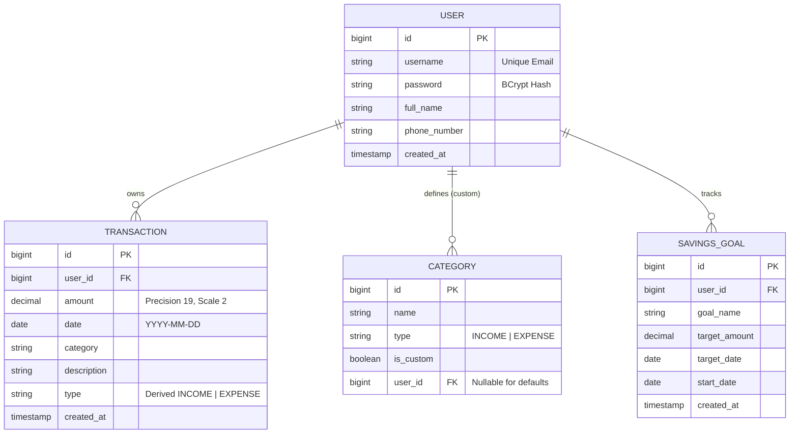

# Personal Finance Manager API

[](https://www.oracle.com/java/)
[](https://spring.io/projects/spring-boot)
[]()
[]()
[](LICENSE)

> [!NOTE]
> ### 📢 Candidate Note: Language Background & AI Usage
> - **Primary Programming Background**: My primary programming experience and day-to-day coding is in **C++** (data structures, algorithms, and core systems).
> - **Framework & Language Transition**: Because the assignment strictly mandates **Java 17+ and Spring Boot**, I utilized AI-assisted pair programming to implement the idiomatic Spring patterns, annotations, and architecture.
> - **Commitment**: Leveraging strong OOP, system design, and computer science foundations from C++, I am very eager, fast to adapt, and excited to rapidly transition and build production-grade backend services in Java/Spring Boot at Syfe.

A production-ready, robust RESTful API backend for personal finance management, designed and implemented for the **Syfe Backend Intern Assignment**.

The system enables users to manage financial transactions with strict data isolation, customize income/expense categories, track savings goals with real-time progress calculations, and generate monthly and yearly financial aggregation reports.

---

## Table of Contents
1. [Key Features](#key-features)
2. [Technology Stack](#technology-stack)
3. [Architecture & Design](#architecture--design)
4. [Entity Relationship Model](#entity-relationship-model)
5. [Prerequisites & Quick Start](#prerequisites--quick-start)
6. [Testing & Code Coverage](#testing--code-coverage)
7. [Authentication & Session Flow](#authentication--session-flow)
8. [API Reference & Contract](#api-reference--contract)
9. [Business Rules & Edge Cases](#business-rules--edge-cases)
10. [Containerization & Deployment](#containerization--deployment)
11. [Submission Details](#submission-details)

---

## Key Features

- **Session-Based Authentication**: Secure server-side sessions using HTTP cookies (`JSESSIONID`) with BCrypt password hashing and data isolation per user.
- **Strict Data Scoping**: All financial resources (transactions, custom categories, goals, reports) are strictly scoped to the authenticated user. Guessing or referencing foreign IDs returns safe 404 responses.
- **Financial Precision**: All monetary values use `BigDecimal` with two decimal places (`HALF_UP` rounding). Floating-point arithmetic is strictly avoided.
- **Category System**: Built-in immutable default categories (`Salary` as INCOME; `Food`, `Rent`, `Transportation`, `Entertainment`, `Healthcare`, `Utilities` as EXPENSE) plus user-defined custom categories with conflict detection and deletion guards.
- **Immutable Transaction Dates**: Enforces business data integrity by preventing back-dating or modifying dates post-creation.
- **Dynamic Savings Goals**: Real-time progress tracking, progress percentage, and remaining amount dynamically calculated from user cash flow on/after goal start dates.
- **Analytics & Reporting**: Calendar-aware monthly and yearly aggregation broken down by categories, computing net savings (`Total Income - Total Expenses`).
- **Comprehensive Quality Suite**: 72 automated JUnit 5 & MockMvc unit/integration tests achieving **90.88% JaCoCo line coverage** and 43 automated end-to-end API smoke test scenarios with a 100% success rate.

---

## Technology Stack

| Layer | Component | Version / Description |
|---|---|---|
| **Language** | Java | 17 (Microsoft OpenJDK / Eclipse Temurin) |
| **Framework** | Spring Boot | 3.3.4 |
| **Security** | Spring Security | 6.x (Session-based, BCrypt encoder) |
| **Persistence** | Spring Data JPA / Hibernate | 6.5.x (Object-Relational Mapping) |
| **Databases** | H2 Database (in-memory) / PostgreSQL | H2 for tests/local dev; PostgreSQL ready for production |
| **Validation** | Jakarta Bean Validation | Hibernate Validator |
| **Testing** | JUnit 5, Mockito, Spring Boot Test, MockMvc | 72 unit/integration tests |
| **Code Coverage** | JaCoCo Maven Plugin | 0.8.12 (90.88% line coverage) |
| **Build Tool** | Apache Maven & Maven Wrapper | Maven 3.9.9 (`mvnw`, `mvnw.cmd`) |
| **Container** | Docker & Docker Compose | Multi-stage lightweight Alpine runner |

---

## Architecture & Design

The application follows the layered architecture pattern:

```
[ HTTP Requests / Cookies ]
            │
            ▼
┌───────────────────────────────┐
│        Spring Security        │ ── Session Authentication & Access Control
└───────────┬───────────────────┘
            │
            ▼
┌───────────────────────────────┐
│      Controller Layer         │ ── Request Routing, DTO Validation, HTTP Status Codes
│ (@RestController, Validation) │
└───────────┬───────────────────┘
            │
            ▼
┌───────────────────────────────┐
│        Service Layer          │ ── Core Business Logic, Data Isolation, Calculations
│   (@Service, @Transactional)  │
└───────────┬───────────────────┘
            │
            ▼
┌───────────────────────────────┐
│       Repository Layer        │ ── Spring Data JPA, JPQL Queries, Indexing
│    (@Repository, Entities)    │
└───────────┬───────────────────┘
            │
            ▼
┌───────────────────────────────┐
│      Database (H2 / PG)       │ ── ACID Persistence & Relational Constraints
└───────────────────────────────┘
```

- **DTO Separation**: Internal persistence entities (`User`, `Category`, `Transaction`, `SavingsGoal`) are decoupled from external request/response payloads (`dto.request.*`, `dto.response.*`).
- **Centralized Exception Handling**: `@RestControllerAdvice` translates domain exceptions (`ResourceNotFoundException`, `BadRequestException`, `ConflictException`, `ForbiddenException`, `UnauthorizedException`) into standardized error envelopes without exposing internal stack traces or secrets.

---

## Entity Relationship Model



---

## Prerequisites & Quick Start

### Prerequisites
- **Java 17+** (JDK 17 or higher)
- **Git**
- *Optional:* Maven 3.9+ (the repository includes `./mvnw` and `mvnw.cmd` wrappers)

### 1. Clone & Build
```bash
# Clone the repository
git clone https://github.com/Nischal-Agrawal/Backend_Work.git
cd Backend_Work

# Build using Maven Wrapper
./mvnw clean package -DskipTests    # Linux / macOS / Git Bash
.\mvnw.cmd clean package -DskipTests # Windows PowerShell
```

### 2. Run Locally
```bash
# Run via Maven
./mvnw spring-boot:run

# Or run the packaged executable JAR
java -jar target/personal-finance-manager-1.0.0.jar
```
The server will start on port `8080` (or the port specified by `$PORT`).
Health check: [http://localhost:8080/api/health](http://localhost:8080/api/health)

---

## Testing & Code Coverage

### Run Automated Tests
```bash
./mvnw clean test
```

### Measured Test Metrics
- **Tests Executed**: **72**
- **Test Failures**: **0**
- **Test Errors**: **0**
- **JaCoCo Line Coverage**: **90.88%** (787 of 866 lines covered, significantly exceeding the 80% threshold)
- JaCoCo HTML Report Location: `target/site/jacoco/index.html`

### Run End-to-End Smoke Test Suite
The repository includes an end-to-end API smoke test runner using curl and cookie jars:
```bash
# Bash (Linux, macOS, or Git Bash on Windows):
bash scripts/smoke_test.sh http://localhost:8080/api

# PowerShell (Windows):
powershell -ExecutionPolicy Bypass -File scripts/smoke_test.ps1 -BaseUrl http://localhost:8080/api
```
All 43 scenarios pass with a 100% success rate. The output report is saved in `submission/test-report.txt` and verified in `submission/test-report.png`.

---

## Authentication & Session Flow

The API uses **Spring Security HTTP Sessions** with secure cookie handling.

1. **Register**: Send `POST /api/auth/register`. A new account is created and password hashed with BCrypt.
2. **Login**: Send `POST /api/auth/login`. On credentials match, Spring Security creates a server-side session and returns a `Set-Cookie: JSESSIONID=...` header.
3. **Subsequent Calls**: Include the session cookie with requests (`-b cookies.txt` in curl).
4. **Logout**: Send `POST /api/auth/logout`. Invalidate the server-side session and clear cookie state.

### Testing with `curl`

```bash
# 1. Register
curl -X POST http://localhost:8080/api/auth/register \
  -H "Content-Type: application/json" \
  -d '{"username":"john@example.com","password":"password123","fullName":"John Doe","phoneNumber":"+1234567890"}'

# 2. Login & save session cookie
curl -X POST http://localhost:8080/api/auth/login \
  -H "Content-Type: application/json" \
  -c cookies.txt \
  -d '{"username":"john@example.com","password":"password123"}'

# 3. Access protected API using session cookie
curl -X GET http://localhost:8080/api/transactions \
  -b cookies.txt

# 4. Logout
curl -X POST http://localhost:8080/api/auth/logout \
  -b cookies.txt
```

---

## API Reference & Contract

Base URL: `http://localhost:8080/api`

### 1. Authentication
| Method | Path | Auth Required | Description | Status Codes |
|---|---|---|---|---|
| `POST` | `/api/auth/register` | No | Register new user | `201`, `400`, `409` |
| `POST` | `/api/auth/login` | No | Authenticate & create session | `200`, `400`, `401` |
| `POST` | `/api/auth/logout` | Yes | Invalidate session | `200`, `401` |

#### Registration Request (`POST /api/auth/register`)
```json
{
  "username": "user@example.com",
  "password": "password123",
  "fullName": "John Doe",
  "phoneNumber": "+1234567890"
}
```
*Response (`201 Created`):*
```json
{
  "message": "User registered successfully",
  "userId": 1
}
```

#### Login Request (`POST /api/auth/login`)
```json
{
  "username": "user@example.com",
  "password": "password123"
}
```
*Response (`200 OK`):*
```json
{
  "message": "Login successful"
}
```

---

### 2. Category Management
| Method | Path | Auth Required | Description | Status Codes |
|---|---|---|---|---|
| `GET` | `/api/categories` | Yes | List default & custom categories | `200`, `401` |
| `POST` | `/api/categories` | Yes | Create custom category | `201`, `400`, `401`, `409` |
| `DELETE` | `/api/categories/{name}` | Yes | Delete custom category | `200`, `400`, `401`, `403`, `404`, `409` |

#### Built-in Default Categories
- **INCOME**: `Salary`
- **EXPENSE**: `Food`, `Rent`, `Transportation`, `Entertainment`, `Healthcare`, `Utilities`

#### Create Category Request (`POST /api/categories`)
```json
{
  "name": "SideBusinessIncome",
  "type": "INCOME"
}
```
*Response (`201 Created`):*
```json
{
  "name": "SideBusinessIncome",
  "type": "INCOME",
  "isCustom": true
}
```

---

### 3. Transaction Management
| Method | Path | Auth Required | Description | Status Codes |
|---|---|---|---|---|
| `POST` | `/api/transactions` | Yes | Create financial transaction | `201`, `400`, `401` |
| `GET` | `/api/transactions` | Yes | Filter & list transactions | `200`, `400`, `401` |
| `PUT` | `/api/transactions/{id}` | Yes | Update transaction | `200`, `400`, `401`, `404` |
| `DELETE` | `/api/transactions/{id}` | Yes | Delete transaction | `200`, `401`, `404` |

#### Create Transaction (`POST /api/transactions`)
```json
{
  "amount": 50000.00,
  "date": "2024-01-15",
  "category": "Salary",
  "description": "January Salary"
}
```
*Response (`201 Created`):*
```json
{
  "id": 1,
  "amount": 50000.00,
  "date": "2024-01-15",
  "category": "Salary",
  "description": "January Salary",
  "type": "INCOME"
}
```

#### Query Parameters for Listing (`GET /api/transactions`)
- `startDate` (optional, `YYYY-MM-DD`): Filter transactions on/after start date.
- `endDate` (optional, `YYYY-MM-DD`): Filter transactions on/before end date.
- `categoryId` (optional, integer): Filter by specific category ID.
- `category` (optional, string): Filter by category name (case-insensitive).
- `type` (optional, `INCOME` or `EXPENSE`): Filter by transaction type.

---

### 4. Savings Goals
| Method | Path | Auth Required | Description | Status Codes |
|---|---|---|---|---|
| `POST` | `/api/goals` | Yes | Create savings goal | `201`, `400`, `401` |
| `GET` | `/api/goals` | Yes | List goals with progress | `200`, `401` |
| `GET` | `/api/goals/{id}` | Yes | Get single goal with progress | `200`, `401`, `404` |
| `PUT` | `/api/goals/{id}` | Yes | Update target amount / date | `200`, `400`, `401`, `404` |
| `DELETE` | `/api/goals/{id}` | Yes | Delete savings goal | `200`, `401`, `404` |

#### Create Goal Request (`POST /api/goals`)
```json
{
  "goalName": "Emergency Fund",
  "targetAmount": 5000.00,
  "targetDate": "2026-01-01",
  "startDate": "2025-01-01"
}
```
*Response (`201 Created`):*
```json
{
  "id": 1,
  "goalName": "Emergency Fund",
  "targetAmount": 5000.00,
  "targetDate": "2026-01-01",
  "startDate": "2025-01-01",
  "currentProgress": 1000.00,
  "progressPercentage": 20.0,
  "remainingAmount": 4000.00
}
```

---

### 5. Reports and Analytics
| Method | Path | Auth Required | Description | Status Codes |
|---|---|---|---|---|
| `GET` | `/api/reports/monthly/{year}/{month}` | Yes | Monthly financial summary | `200`, `400`, `401` |
| `GET` | `/api/reports/yearly/{year}` | Yes | Yearly financial summary | `200`, `400`, `401` |

#### Monthly Report Sample (`GET /api/reports/monthly/2024/1`)
```json
{
  "month": 1,
  "year": 2024,
  "totalIncome": {
    "Salary": 3000.00,
    "Freelance": 500.00
  },
  "totalExpenses": {
    "Food": 400.00,
    "Rent": 1200.00,
    "Transportation": 200.00
  },
  "netSavings": 1700.00
}
```

---

## Business Rules & Edge Cases

1. **Data Isolation**: All transactions, custom categories, goals, and reports are owned by the authenticated user. Requests targeting unowned resources return `404 Not Found` rather than leaking existence.
2. **Immutable Date**: The transaction `date` cannot be modified via `PUT /api/transactions/{id}`. Attempts to change it yield `400 Bad Request`.
3. **Derived Transaction Type**: `type` is automatically derived from the referenced category (`INCOME` or `EXPENSE`).
4. **Future Dates**: Transactions with future dates are rejected with `400 Bad Request`.
5. **Default Category Protection**: Built-in default categories cannot be deleted or modified (`403 Forbidden`).
6. **Referential Integrity**: Custom categories referenced by existing transactions cannot be deleted (`409 Conflict`).
7. **Savings Progress Arithmetic**:
   - `currentProgress = Total Income - Total Expenses` for all transactions with `date >= goal.startDate`.
   - `progressPercentage = (currentProgress / targetAmount) * 100` (capped safely, returns `0.0` if net progress is non-positive).
   - `remainingAmount = max(0, targetAmount - currentProgress)`.
8. **Deterministic Reports**: Periods without transactions cleanly return empty maps and `0.00` net savings (HTTP 200, never 500).

---

## Containerization & Deployment

### Docker Multi-Stage Build
A production-ready `Dockerfile` is included:
```bash
# Build Docker image
docker build -t personal-finance-manager .

# Run container
docker run -p 8080:8080 personal-finance-manager
```

### Render Deployment (`render.yaml`)
A `render.yaml` blueprint is configured for zero-configuration deployment to [Render](https://render.com):
1. Create a new Blueprint on Render dashboard pointing to this repository.
2. Render detects `render.yaml` and deploys as a Docker web service.
3. Live health check is configured at `/api/health`.

---

## Submission Details

- **Candidate**: Nischal Agrawal
- **Email**: `nishchal.agrawal.ug23@nsut.ac.in`
- **Repository**: Public GitHub Repository
- **Test Artifacts**: `submission/test-report.txt` and `submission/test-report.png`
- **Submission Details Manifest**: `submission/submission-details.txt`
